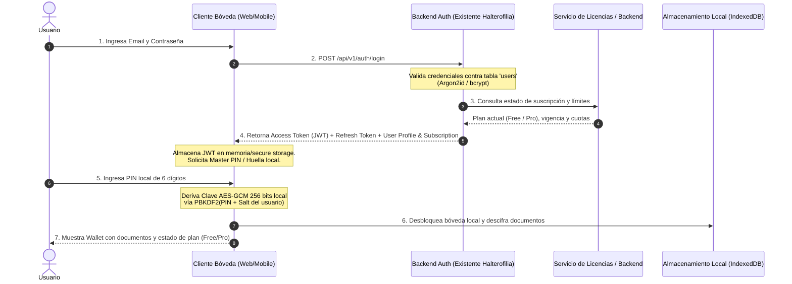

# Arquitectura del Sistema — Bóveda Digital (Wallet de Documentos)

Documento de especificación técnica, integración con backend existente, modelo criptográfico y modelo de negocio para la plataforma **Bóveda Digital**.

---

## 1. Visión General del Producto y Arquitectura

**Bóveda Digital** es una billetera inteligente y segura de documentos personales y comerciales (cédulas, pasaportes, licencias de conducir, tarjetas, pólizas, títulos de propiedad).
- **Paradigma de Privacidad:** Arquitectura **Zero-Knowledge** (Conocimiento Cero). El backend nunca conoce las claves maestras ni almacena documentos en texto claro.
- **Acceso 100% Offline:** Persistencia local cifrada mediante **IndexedDB** y la API nativa de **Web Crypto** (AES-256-GCM).
- **Compatibilidad con Backend Existente:** Reutiliza la infraestructura de autenticación de la app de Halterofilia (API REST, tokens JWT / OAuth2, refresh tokens rotativos y sesiones en base de datos centralizada).

---

## 2. Flujo de Autenticación Unificado y Ciclo de Vida del Token

El cliente de Bóveda Digital se autentica contra el mismo servicio de identidad del ecosistema de aplicaciones del desarrollador, agregando una capa de protección criptográfica local (Master PIN / Biometría WebAuthn).



### Detalle del Token JWT (Claims)
El Access Token emitido por el backend incluye los claims compartidos entre Halterofilia y Bóveda Digital:

```json
{
  "iss": "https://auth.miapp-ecosystem.com",
  "sub": "usr_9b1deb4d-3b7d-4bad-9bdd-2b0d7b3dcb6d",
  "email": "usuario@ejemplo.com",
  "roles": ["user"],
  "apps": ["halterofilia", "boveda_digital"],
  "subscription": {
    "plan": "pro",
    "status": "active",
    "max_docs": -1,
    "cloud_sync_enabled": true,
    "expires_at": 1798761600
  },
  "iat": 1760731200,
  "exp": 1760732100
}
```

---

## 3. Modelo Criptográfico Zero-Knowledge (Cifrado en Reposo y Tránsito)

1. **Derivación de Clave Maestra:**
   $$\text{MasterKey} = \text{PBKDF2-HMAC-SHA256}(\text{PIN/Passphrase}, \text{Salt}_{\text{user}}, 100\,000 \text{ iteraciones}, 256 \text{ bits})$$
2. **Cifrado de Documentos (AES-256-GCM):**
   - Para cada documento o archivo adjunto se genera un vector de inicialización único e irrepetible ($\text{IV}$ de 12 bytes / 96 bits).
   - Se cifra el payload binario o JSON de metadatos generando el texto cifrado ($\text{Ciphertext}$) y el tag de autenticación de integridad (128 bits).
   - $\text{IntegrityChecksum} = \text{SHA-256}(\text{Ciphertext})$.
3. **Sincronización Segura:**
   - Cuando el usuario sincroniza con la nube, el backend **solo recibe el Ciphertext, el IV y el Checksum**. Ningún administrador o atacante que comprometa la base de datos central puede acceder a los datos de los documentos.

---

## 4. Modelo de Datos (DB Schema & JSON)

### Esquema Relacional de Base de Datos (PostgreSQL)

```sql
-- Tabla de Usuarios (Compartida con App Halterofilia)
CREATE TABLE users (
    id UUID PRIMARY KEY DEFAULT gen_random_uuid(),
    email VARCHAR(255) NOT NULL UNIQUE,
    password_hash VARCHAR(255) NOT NULL,
    full_name VARCHAR(150),
    is_active BOOLEAN DEFAULT TRUE,
    created_at TIMESTAMP WITH TIME ZONE DEFAULT CURRENT_TIMESTAMP,
    updated_at TIMESTAMP WITH TIME ZONE DEFAULT CURRENT_TIMESTAMP
);

-- Tabla de Licencias y Planes de Suscripción (Bóveda Digital & Ecosistema)
CREATE TABLE subscriptions (
    id UUID PRIMARY KEY DEFAULT gen_random_uuid(),
    user_id UUID NOT NULL REFERENCES users(id) ON DELETE CASCADE,
    app_identifier VARCHAR(50) DEFAULT 'boveda_digital', -- 'boveda_digital' | 'halterofilia'
    plan_tier VARCHAR(30) NOT NULL DEFAULT 'free',       -- 'free', 'pro_monthly', 'pro_annual'
    status VARCHAR(30) NOT NULL DEFAULT 'active',        -- 'active', 'trial', 'past_due', 'canceled'
    max_documents INT DEFAULT 5,                         -- 5 en Free, -1 para ilimitado en Pro
    cloud_sync_enabled BOOLEAN DEFAULT FALSE,
    external_provider VARCHAR(50),                       -- 'stripe', 'apple_iap', 'google_play'
    external_subscription_id VARCHAR(255),
    current_period_start TIMESTAMP WITH TIME ZONE,
    current_period_end TIMESTAMP WITH TIME ZONE,
    created_at TIMESTAMP WITH TIME ZONE DEFAULT CURRENT_TIMESTAMP,
    updated_at TIMESTAMP WITH TIME ZONE DEFAULT CURRENT_TIMESTAMP
);

-- Tabla de Documentos Cifrados en Nube (Metadatos y Payloads Blindados)
CREATE TABLE vault_documents (
    id UUID PRIMARY KEY DEFAULT gen_random_uuid(),
    user_id UUID NOT NULL REFERENCES users(id) ON DELETE CASCADE,
    client_document_id VARCHAR(64) NOT NULL,            -- UUID generado en cliente
    encrypted_category VARCHAR(255) NOT NULL,           -- Categoría cifrada con AES-GCM
    encrypted_payload TEXT NOT NULL,                    -- Metadatos y campos estructurados cifrados
    encrypted_file_url TEXT,                            -- Ubicación en Object Storage (archivo cifrado)
    iv_vector VARCHAR(64) NOT NULL,                     -- IV Base64 (12 bytes)
    sha256_checksum VARCHAR(64) NOT NULL,               -- Hash de integridad
    sync_version INT DEFAULT 1,
    is_deleted BOOLEAN DEFAULT FALSE,                   -- Soporte para Soft-delete en sync offline
    created_at TIMESTAMP WITH TIME ZONE DEFAULT CURRENT_TIMESTAMP,
    updated_at TIMESTAMP WITH TIME ZONE DEFAULT CURRENT_TIMESTAMP,
    UNIQUE(user_id, client_document_id)
);

-- Tabla de Enlaces Temporales Compartidos (Secure Share)
CREATE TABLE document_shares (
    id UUID PRIMARY KEY DEFAULT gen_random_uuid(),
    user_id UUID NOT NULL REFERENCES users(id) ON DELETE CASCADE,
    share_token VARCHAR(128) NOT NULL UNIQUE,           -- Token de un solo uso o temporal
    encrypted_payload TEXT NOT NULL,                    -- Payload cifrado con clave efímera
    iv_vector VARCHAR(64) NOT NULL,
    passcode_hash VARCHAR(255),                         -- Hash Argon2id de la clave temporal opcional
    views_limit INT DEFAULT 1,                          -- Número de accesos permitidos
    views_count INT DEFAULT 0,
    expires_at TIMESTAMP WITH TIME ZONE NOT NULL,
    created_at TIMESTAMP WITH TIME ZONE DEFAULT CURRENT_TIMESTAMP
);
```

---

## 5. Estructura de Endpoints de la API REST

Todos los endpoints requieren HTTPS y cabecera `Authorization: Bearer <JWT>` (salvo endpoints públicos de login y registro).

| Dominio | Método | Endpoint | Descripción | Requiere Pro |
|---|---|---|---|---|
| **Autenticación** | `POST` | `/api/v1/auth/register` | Registro de usuario (compatible con ecosistema). | No |
| **Autenticación** | `POST` | `/api/v1/auth/login` | Login con credenciales. Retorna JWT y suscripción. | No |
| **Autenticación** | `POST` | `/api/v1/auth/refresh` | Refresca el token de acceso JWT. | No |
| **Autenticación** | `GET` | `/api/v1/auth/me` | Obtiene el perfil del usuario autenticado. | No |
| **Suscripción** | `GET` | `/api/v1/subscription/status` | Estado de la licencia, cuota de documentos y expiración. | No |
| **Suscripción** | `POST` | `/api/v1/subscription/checkout` | Genera sesión de pago (Stripe / IAP) para Plan Pro. | No |
| **Suscripción** | `POST` | `/api/v1/subscription/webhook` | Webhook para procesar eventos de Stripe/Apple/Google. | Servidor |
| **Documentos** | `GET` | `/api/v1/documents` | Lista metadatos cifrados del usuario en la nube. | Sí (Sync) |
| **Documentos** | `POST` | `/api/v1/documents/batch-sync`| Sincronización bidireccional offline-first con control de versiones. | Sí (Sync) |
| **Documentos** | `POST` | `/api/v1/documents` | Crea/sube un documento cifrado (valida cuota Free: máx 5). | No |
| **Documentos** | `DELETE`| `/api/v1/documents/:id` | Elimina o marca soft-delete en la nube. | No |
| **Compartición**| `POST` | `/api/v1/share/create` | Genera enlace efímero con expiración y contraseña. | No |
| **Compartición**| `GET` | `/api/v1/share/:token` | Consulta el payload cifrado del enlace compartido. | No |
