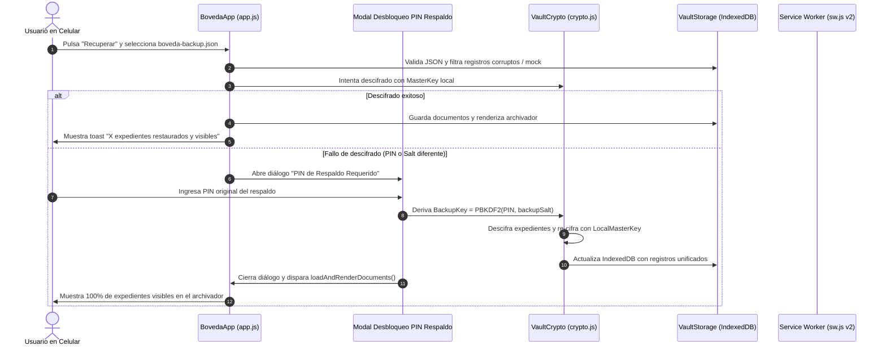

# Plan de Implementación — Spec 002: Restauración de Respaldo Multi-Dispositivo y Portabilidad Criptográfica

## Resumen Ejecutivo
Este plan detalla la arquitectura técnica, las modificaciones en los módulos del cliente y servidor, y los pasos secuenciales necesarios para corregir el problema de recuperación de respaldos en dispositivos móviles.

---

## 1. Arquitectura y Diagnóstico Técnico

### Flujo Criptográfico Actual vs. Flujo Criptográfico Resiliente

---

## 2. Modificaciones por Componente

### A. Limpieza de Datos y Aislamiento en Backend (`server.js`, `tests/server.test.js`, `data/vault_cloud.json`)
1. **`tests/server.test.js`:**
   - Asignar `process.env.NO_DISK_PERSIST = 'true'` antes de requerir `server.js` para que las pruebas nunca persistan registros ficticios en disco.
2. **`data/vault_cloud.json`:**
   - Purgar los 24 documentos de prueba espurios (`'U2FsdGVkX1+payload...'`) de `usr_pro_001`.
   - Preservar intactos los 5 documentos reales legítimos (`Rut Chileno`, `Partida de Nacimiento Christian Cardenas`, `Partida de Nacimiento Mariam Aguiar`, `Certificado de Antecedentes Penales`, `Cedula de Identidad`).
   - Normalizar el `cryptoSalt` de `usr_pro_001` a `'226000658459336d4184642799fc8498'` para coincidir con la sal real de los documentos existentes.

### B. Validación y Sanitización de Expedientes (`assets/js/storage.js`)
1. **`validarDocumentoReal(doc)`:**
   - Comprobar que `doc.encrypted_payload` supere una longitud mínima (> 40 caracteres en Base64), que el `iv` tenga 16 caracteres Base64 (12 bytes) y que no contenga patrones dummy (`U2FsdGVkX1+payload`).
2. **`serializarBackupBoveda` & `fusionarDocumentosBackup`:**
   - Descartar automáticamente registros de prueba corruptos para que nunca se exporten en el archivo JSON ni se mezclen en `IndexedDB`.
3. **Identificación de Sal Efectiva en Exportación:**
   - Exportar en el JSON la sal con la que están efectivamente cifrados los expedientes activos.

### C. Asistente Interactivo de PIN y Sesión Segura (`assets/js/auth.js`, `assets/js/app.js`, `index.html`)
1. **`assets/js/auth.js`:**
   - Almacenar el PIN activo en `sessionStorage` (`_vault_session_pin`) durante el ciclo de vida de la sesión (eliminado automáticamente al bloquear o cerrar la pestaña), asegurando que `lastEnteredPin` esté siempre disponible para operaciones de importación sin importar recargas de página.
2. **`index.html`:**
   - Añadir el diálogo modal `#modal-backup-pin-prompt` con teclado táctil numérico y formulario accesible para introducir el PIN maestro del respaldo si se detecta discrepancia criptográfica.
3. **`assets/js/app.js`:**
   - Al importar un respaldo, comprobar si el PIN actual o las sales candidatas descifran los documentos. Si fallan, presentar el modal `#modal-backup-pin-prompt`.
   - Tras ingresar el PIN del respaldo, descifrar todos los expedientes, re-cifrarlos en caliente con la clave activa del celular y actualizar `IndexedDB`.
   - Ajustar el toast de éxito para indicar con total precisión los expedientes realmente visibles.

### D. Actualización de Caché y Service Worker (`sw.js`)
1. Incrementar `CACHE_NAME` a `'boveda-digital-v2'`.
2. Implementar estrategia *Network-First* con contingencia en caché para scripts (`.js`), garantizando que cualquier cambio en la lógica criptográfica o de interfaz se aplique de inmediato en dispositivos móviles.

---

## 3. Plan de Pruebas y Validación
1. **Prueba Unitaria de Sanitización:** Validar que los documentos mock son filtrados en importación y exportación.
2. **Prueba Unitaria de Respaldo y Restauración Multi-PIN:** Validar que un conjunto de documentos cifrados con `PIN A` y `Salt A` se pueden descifrar y re-cifrar con `PIN B` y `Salt B`.
3. **Prueba de Aislamiento de Persistencia:** Verificar que ejecutar `tests/server.test.js` no modifica `data/vault_cloud.json`.
4. **Prueba de Service Worker:** Verificar que `sw.js` contiene `boveda-digital-v2` y la estrategia de actualización.
5. **Verificación de Suite Completa:** `node --test tests/boveda.test.js tests/server.test.js` con 100% de tests en verde.
