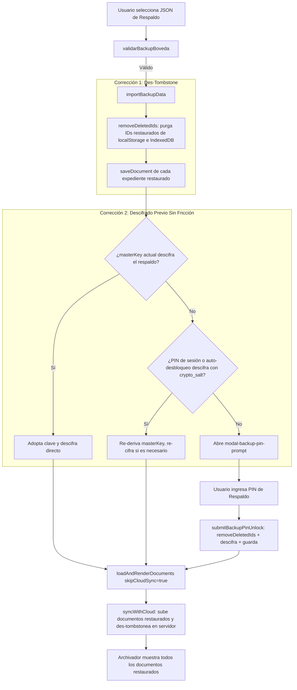

# PLAN-018: Recuperación de Respaldos Sin Fricción y Des-Tombstone Automático

## 1. Arquitectura y Análisis de Flujos

### Flujo de Importación Actual vs Flujo Corregido

## 2. Modificaciones Concretas

1. **`assets/js/storage.js`:**
   - Implementar `removeDeletedIds(idsToRemove)` en la clase `VaultStorage`.
   - Modificar `getDeletedIds()` para permitir la des-eliminación explícita mediante un registro de excepciones (`boveda_undeleted_doc_ids`).
   - En `importBackupData(backupData, userId)`:
     - Extraer los IDs de todos los documentos válidos a restaurar (`validBackupDocs.map(d => d.id)`).
     - Invocar `await this.removeDeletedIds(restoredIds)`.
     - Guardar los documentos en `IndexedDB`.

2. **`server.js`:**
   - En `POST /api/v1/documents/batch-sync`:
     - Al procesar cada documento válido no-demo (`!String(doc.id).startsWith('doc_demo_')`), invocar `db.deletedIds.delete(doc.id)` para des-tombstonear en la base de datos central de Cloud Run.
     - Soportar el arreglo opcional `unDeletedIds` en el body para depurar la lista central de tombstones.

3. **`assets/js/app.js`:**
   - En `handleImportBackup(file)`:
     - Probar proactivamente si `window.vaultAuth.masterKey` descifra al menos un documento del respaldo.
     - Si la clave activa no coincide o no existe, probar las sales candidatas con los PINs disponibles en memoria (`lastEnteredPin`, `sessionStorage`, `vaultPinRawSecret_`, `'123456'`).
     - Si alguna combinación descifra, actualizar la clave activa en `window.vaultAuth` sin molestar al usuario.
     - Llamar a `loadAndRenderDocuments(true)` (con `skipCloudSync = true`) para pintar los expedientes de inmediato.
     - Únicamente si el total de documentos descifrados en memoria es 0 y ninguna combinación automática funcionó, abrir `#modal-backup-pin-prompt`.
     - Ejecutar `syncWithCloud(true)` al finalizar para sincronizar y des-tombstonear en servidor.
   - En `submitBackupPinUnlock()`:
     - Invocar `await window.vaultStorage.removeDeletedIds(restoredIds)` para asegurar que ningún expediente quede bloqueado en tombstones.
     - Guardar los documentos re-cifrados.
     - Llamar a `await this.loadAndRenderDocuments(true)` y `await this.syncWithCloud(true)`.

4. **Service Worker:**
   - Actualizar a `boveda-digital-v22` en `sw.js` e `index.html`.

5. **Pruebas Automatizadas:**
   - Agregar casos de prueba en `tests/boveda.test.js` y `tests/server.test.js` que validen:
     - `removeDeletedIds` des-tombstonea documentos eliminados.
     - `importBackupData` restaura documentos previamente eliminados.
     - `POST /api/v1/documents/batch-sync` remueve IDs restaurados de `db.deletedIds`.

