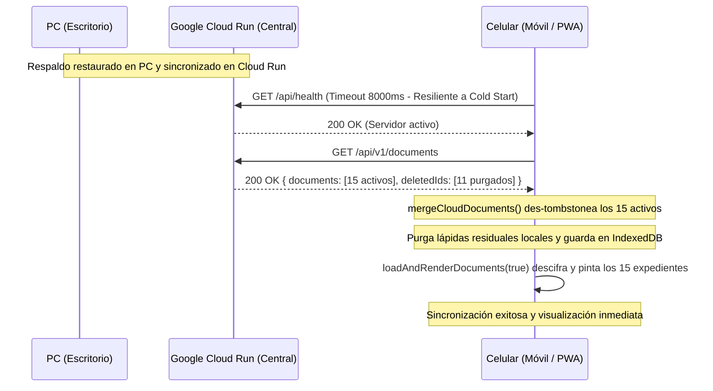

# Plan de Implementación — Especificación 019: Resiliencia de Sincronización en Celular y Des-Tombstone Cruzado

## 1. Arquitectura de Sincronización Celular ↔ Cloud Run ↔ PC

## 2. Modificaciones Requeridas

### A. `assets/js/storage.js`
1. En `mergeCloudDocuments(cloudDocs, deletedIds)`:
   - Extraer `incomingActiveIds` de los documentos válidos de la nube (`validCloudDocs = cloudDocs.filter(d => esPayloadCifradoValido(d) && !d.id.startsWith('doc_demo_'))`).
   - Invocar de inmediato `await this.removeDeletedIds(incomingActiveIds)` para limpiar cualquier lápida local residual del celular.
   - Filtrar los `deletedIds` del servidor para que nunca agreguen IDs de documentos que acaban de llegar como activos (`genuineDeleted = deletedIds.filter(id => !incomingActiveSet.has(id))`).
   - Guardar y sincronizar sin interrupciones.

### B. `assets/js/auth.js`
1. En `checkServerConnection()`:
   - Incrementar el timeout de `2500` ms a `8000` ms para evitar falsos "Offline" en redes móviles celulares y arranques en frío de Google Cloud Run.

### C. `assets/js/app.js`
1. En `testCloudConnection()`:
   - Incrementar el timeout de `4000` ms a `8000` ms.
2. En `syncWithCloud()`:
   - Asegurar que si `checkServerConnection()` tiene éxito o si el token ya está en memoria, la sincronización proceda directamente.

### D. `server.js` y `data/vault_cloud.json`
1. En `server.js`:
   - Blindar `batch-sync` para que jamás des-tombstonee ni inserte registros en `INITIAL_PURGED_DOC_IDS` (`doc_bba1vso67`, `doc_lroukh0y9`, `doc_shm2e0xo1`, etc.).
   - Purgar de `db.documents.usr_pro_001` cualquier registro residual de `INITIAL_PURGED_DOC_IDS` y asegurar que queden registrados en `db.deletedIds`.
2. En `data/vault_cloud.json`:
   - Limpiar cualquier residuo de `INITIAL_PURGED_DOC_IDS`.

### E. Service Worker v23 y Tests
1. `sw.js`: Bump a `boveda-digital-v23`.
2. `index.html`: Bump `?v=23` en todas las referencias de scripts.
3. `tests/boveda.test.js` y `tests/server.test.js`: Pruebas automatizadas de des-tombstoneo en `mergeCloudDocuments` y blindaje de `INITIAL_PURGED_DOC_IDS`.
